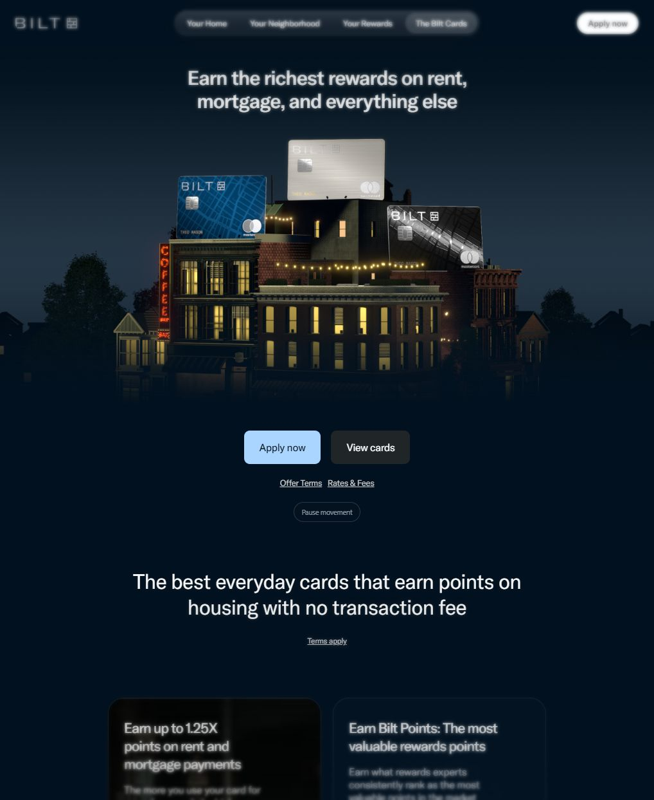

# Bilt Rewards interactive website prototype

A website prototype combining Blender-rendered neighborhood imagery with interactive camera movement and card focus views.



## Run locally

Use a Node.js version supported by the `engines` field in `package.json`.

```sh
npm ci
npm run dev
```

Open the local URL printed by Vite. Blender is not required to run the website; the current render assets are included.

```sh
npm run build
npm run preview
```

The production website is generated in `dist/` and can be served from the root of a static website host.

## Interactions

- Move the mouse across the hero for subtle parallax through 21 Blender-rendered camera views.
- Click a card for a camera zoom and slight rotation. The selected card stays brightest; surrounding lighting dims while retaining building detail.
- Click **All cards** or press **Escape** to return.
- Apartment lights complete their startup sequence over five seconds.
- The neon sign flickers subtly, and the two overhead strings retain a gently varying warm glow.
- Use **Pause movement** to pause the ambient movement.

Each card zoom uses 68 actual Blender camera renders encoded at 60 fps. The navigation, headline fade and call-to-action layout remain part of the HTML/CSS website.

## Project files

- `src/render-sequence.js`: parallax playback and scene integration.
- `src/card-focus.js`: card zoom and return controls.
- `src/native-arrival.js`: full-frame apartment lighting playback.
- `src/neon.js` and `src/string-lights.js`: subtle light effects.
- `public/assets/scene02-*`: the current render set from the corrected Blender scene.

Large Blender authoring files, older render experiments and local dependencies are excluded from this repository. Some non-hero marketing images and links reference the Bilt website and require an internet connection.
